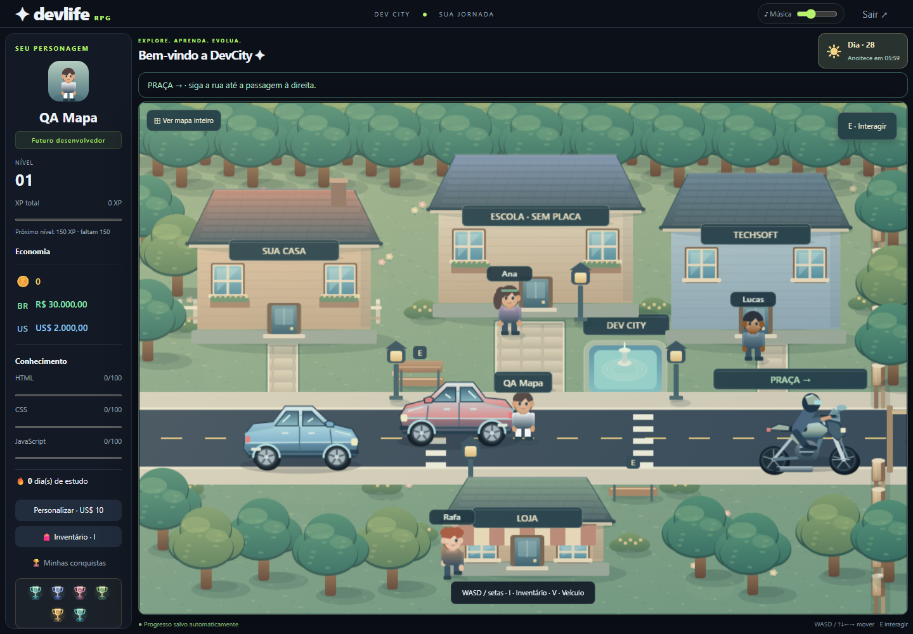

# DevLife

**Edição de portfólio 0.0.01** · [Jogar online](https://techmind.pro.br/devlife/jogo/)

DevLife é um RPG educacional para praticar desenvolvimento web. Você cria um personagem, explora DevCity, estuda na escola e aplica o que aprendeu em trabalhos e projetos. Desafios concluídos liberam novas atividades, oportunidades na carreira e conquistas.



## Executar localmente

Requisitos: Node.js 24 ou superior e pnpm.

```sh
pnpm install --frozen-lockfile
pnpm start
```

Abra [http://localhost:5000](http://localhost:5000/), crie uma conta local e personalize seu personagem. O SQLite cria o arquivo `data/devlife.sqlite` na primeira execução. Encerre o servidor com **Ctrl+C**.

O jogo pode ser testado com cadastro por e-mail e senha. O login por provedores externos exige configuração própria e é opcional.

```sh
pnpm test
```

## Primeiros passos no jogo

1. Caminhe com **WASD**, setas ou clique/toque no cenário.
2. Vá até a escola, aproxime-se da professora e pressione **E** para abrir a primeira aula.
3. Resolva o desafio, confira o resultado e explore as atividades liberadas.

## Como foi feito

| Parte | Implementação |
|---|---|
| Mundo e interface | JavaScript, Canvas 2D, HTML e CSS, com controles para teclado e toque |
| Servidor e progresso | Node.js, HTTP nativo e SQLite, com contas e progresso por jogador |
| Exercícios | Validação de HTML e CSS e execução de desafios de JavaScript em QuickJS/WebAssembly, com limites de tempo e memória |
| Multiplayer | Presença, chat e troca de eventos pelo servidor |
| Testes | Node Test Runner, incluindo exercícios, navegação, progressão e fluxos da API |

O servidor decide quais atividades podem ser liberadas e registra o progresso. O navegador desenha a cidade e exibe o retorno dos desafios. O editor inclui exemplos e prévias para que o jogador consiga experimentar e revisar seu trabalho dentro do jogo.

## Capturas do jogo

- [Trilhas de aprendizagem](docs/imagens/escola.png)
- [Editor de projetos](docs/imagens/projeto.png)

## Créditos

Os créditos e condições de uso dos livros e da trilha ficam em [Acervo](public/books/CREDITOS.md) e [Áudio](public/audio/CREDITOS.md). As dependências e os materiais de terceiros mantêm suas licenças próprias. A marca DevClub pertence aos seus titulares.
